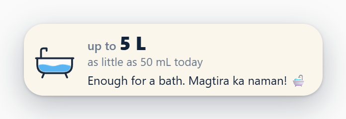
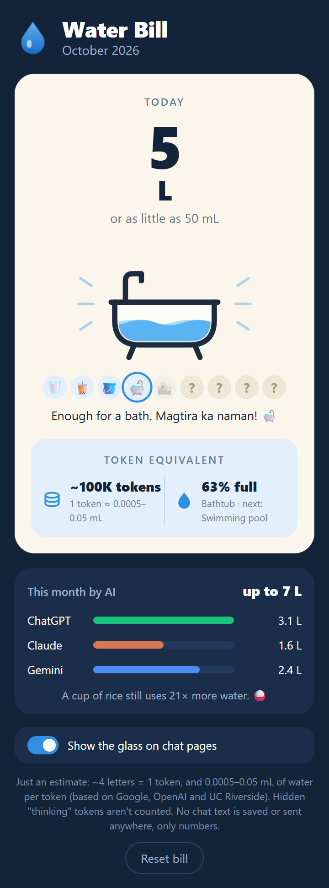
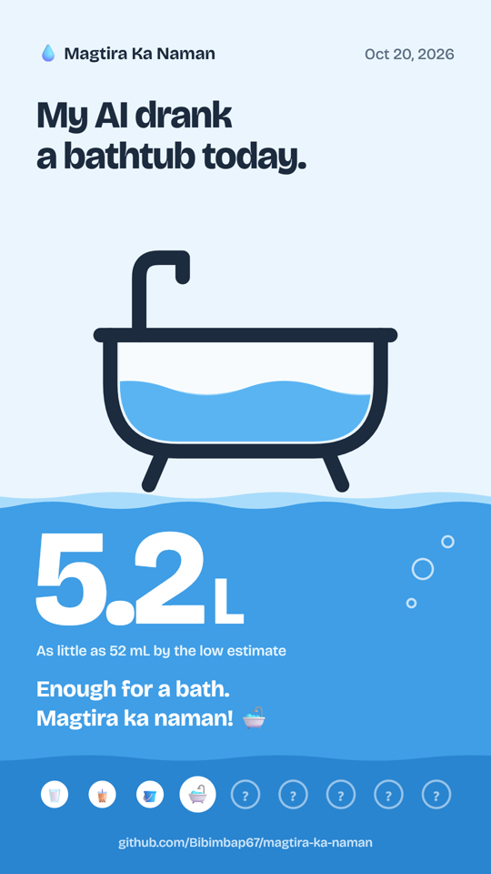
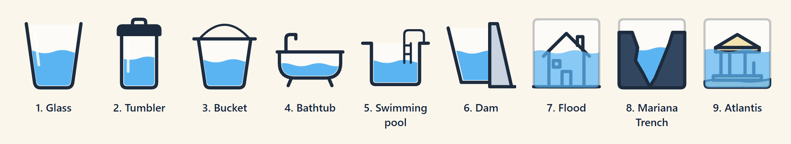
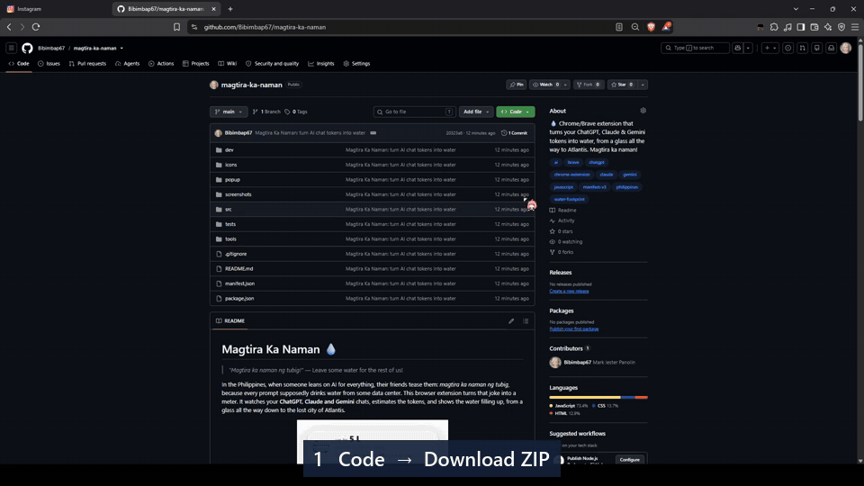

# Magtira Ka Naman 💧

> *"Magtira ka naman ng tubig!"* — Leave some water for the rest of us!

In the Philippines, when someone leans on AI for everything, their friends tease them: *magtira ka naman ng tubig*, because every prompt supposedly drinks water from some data center. This browser extension turns that joke into a meter. It watches your **ChatGPT, Claude and Gemini** chats, estimates the tokens, and shows the water filling up, from a glass all the way down to the lost city of Atlantis.

<p align="center">
  <a href="https://github.com/Bibimbap67/magtira-ka-naman/archive/refs/heads/main.zip"></a><br>
  <a href="#download-and-set-up">How to install it (about a minute)</a>
</p>

<p align="center">
  <br>
  
</p>

It's a joke project with real (but rough) numbers. Nothing you type ever leaves your browser.

## What it does

- **A water glass floats on the chat page** and fills up as you chat. Its waves keep moving. When a reply finishes, drops fall in, the water rises, the numbers count up and a joke line types itself out.
- **When a container is full, the water moves to a bigger one**, and a badge pops up: "Level 2: Tumbler 🧋". It starts over with a glass every day.
- **Click the 💧 icon for your Water Bill:**
  - today's water and container;
  - the levels you've unlocked (the far ones stay a mystery `?`);
  - this month split by AI;
  - how it compares to a cup of rice 🍚.
- **Share your water 📸:** the **Share it with friends** button saves a story-sized picture (1080×1920 PNG) of today's water. Post it on Instagram or Facebook, or send it to a friend. It only has numbers on it, nothing from your chats.
- **Drag the glass anywhere**, click it to fold it small, or turn it off with **Show the glass on chat pages** in the popup. Counting goes on while it's hidden.
- **Compete on the all-time leaderboard 🏆** in the popup's **Leaderboard** tab: pick a nickname and see who is the *pinaka-uhaw sa AI* (thirstiest AI user). It's off until you join ([details](#leaderboard)).

<p align="center">
  
</p>

### From a glass to Atlantis



| Level | Container | Full at | About how many AI replies* |
|---|---|---|---|
| 1 | 🥛 Glass | 250 mL | 10 |
| 2 | 🧋 Tumbler | 1 L | 40 |
| 3 | 🪣 Bucket (timba) | 3 L | 120 |
| 4 | 🛁 Bathtub | 8 L | 320 |
| 5 | 🏊 Swimming pool | 20 L | 800 |
| 6 | 🏞️ Dam | 50 L | 2,000 |
| 7 | 🌊 Flood | 100 L | 4,000 |
| 8 | 🦑 Mariana Trench | 250 L | 10,000 |
| 9 | 🏛️ Atlantis | 1,000 L | 40,000 |

\* Using the high estimate and ~500 tokens per reply. These are game levels, not real sizes: a real bathtub holds ~150 L, which almost nobody would reach in a day. Want it harder? Change `TIERS` in `src/water.js`.

### Fun facts it's built on

- **One cup of cooked rice (kanin) takes ~150 L of water to grow.** By the high estimate, that's about 3 million tokens of chatting. So the popup keeps you humble: *"A cup of rice still uses 21× more water."*
- **Nobody publishes an official "water per token" number**, and the estimates disagree by about 100×, so the extension always shows a **low – high range**:
  - **Low:** Google says a median Gemini prompt uses ~0.26 mL (2025), and OpenAI's Sam Altman says an average ChatGPT query uses ~0.32 mL (2025).
  - **High:** UC Riverside's *Making AI Less Thirsty* (Ren et al.) also counts the water used to make the electricity: roughly 10–50 mL per reply.
- The real number is probably **higher** than what you see. Hidden "thinking" tokens, web searches, and the model rereading the whole conversation every turn are not counted.

## Download and set up

Works in **Brave, Chrome and Edge** (any Chromium browser). No account, no keys, nothing to sign up for. It isn't on the Chrome Web Store yet, and browsers don't allow a one-click install from outside the store, so you load it yourself. It takes about a minute.

<p align="center">
  <a href="https://github.com/Bibimbap67/magtira-ka-naman/archive/refs/heads/main.zip"></a>
</p>



*(The GIF gets the ZIP from the green **Code** button. The download button above does the same thing.)*

1. **Get the files.** Pick one:
   - **ZIP (easiest):** click **Download the ZIP** above, then right-click the file → **Extract all**. Put it somewhere you'll keep it (e.g. your Documents).
   - **Git:**
     ```bash
     git clone https://github.com/Bibimbap67/magtira-ka-naman.git
     ```
2. **Open the extensions page.** Type one of these in the address bar:
   - Brave: `brave://extensions`
   - Chrome: `chrome://extensions`
   - Edge: `edge://extensions`
3. **Turn on Developer mode.** It's a switch in the top right (bottom left in Edge).
4. Click **Load unpacked** and pick the folder that has `manifest.json` directly inside. With the ZIP that's the `magtira-ka-naman-main` folder, and Windows sometimes puts one inside another, so open them until you see `manifest.json`.
5. **Pin it.** Click the puzzle-piece icon in the toolbar, then the pin next to *Magtira Ka Naman 💧*.
6. Open [chatgpt.com](https://chatgpt.com), [claude.ai](https://claude.ai) or [gemini.google.com](https://gemini.google.com) and send a message. The glass shows up at the bottom right and fills once the reply finishes.

**Updating:** with the ZIP, download it again and extract it over the same folder (replace the files). With Git, run `git pull`. Then click ↻ on the extension's card. Open chat tabs pick up the new version by themselves. If an update needs a new permission, the browser may switch the extension off: just turn its switch back on.

**Don't delete or move the folder** after loading it. The browser runs the extension from there.

## Leaderboard

Open the 💧 popup → **Leaderboard** tab → type a nickname → **Join**. You'll see the all-time top 20, with medals 🥇🥈🥉 and everyone's container (a 🦑 Mariana Trench means someone *really* likes AI), plus your own rank even if you're not in the top 20.

- **What's sent:** only a random id, your nickname and your all-time token total (about once a minute while you chat). Never chat text, never your name or email.
- **Nothing at all is sent until you press Join.** Leave any time from the same tab: you're removed from the board.
- **Your total survives "Reset bill"**, so resetting the bill doesn't drop you down the ranks.
- **Nicknames:** 3–20 letters, numbers, spaces and `_ - .`, unique, with a basic bad-word filter (English and Tagalog).
- **Be honest:** totals are counted on each player's own computer, so someone could fake one. The server caps how fast a total can grow (300,000 tokens an hour), but treat the top spots with a pinch of salt. 🧂

The server is a tiny free [Cloudflare Worker](server/README.md). You can run your own.

## FAQ

**Does it read my chats?**
It reads the text on the page only to count letters (~4 letters = 1 token). It saves **only numbers** (tokens per day per AI) in your browser's local storage. Unless you join the leaderboard it makes **no network requests**, and even then only your nickname and total are sent.

**Why does it show a range?**
Because the honest answer is "somewhere between a few drops and a lot". The big number is the high estimate, and the smaller one is the low estimate.

**Will it slow the site down?**
No. It only looks at the page when something changes, and it waits until a reply stops changing before counting it.

**Does it count old chats?**
No. Only messages that appear within 2 minutes after you **send** something are counted. Opening an old chat or reloading the page doesn't add water.

**What permissions does it need?**
- `storage`, to save the numbers.
- `scripting`, for ChatGPT, Claude and Gemini only, so open chat tabs get the new version right after an update.
- `alarms`, and access to the leaderboard server, to send your total about once a minute if you joined.

## How it counts

| Step | What happens |
|---|---|
| Find messages | `src/sites.js` lists CSS selectors for each site, tried in order. If none match, it counts new text in `<main>` instead. |
| Tokens | ~4 characters = 1 token (`src/tokens.js`). |
| When | A message is counted once it stops changing for 1.5 s, so streaming replies aren't counted half-done. |
| What's new | Only messages that appear or change within 2 minutes after you send (Enter or a Send button). |
| Water | tokens × **0.0005 mL** (low) and × **0.05 mL** (high) (`src/water.js`). |

## When it breaks

The chat sites change their HTML often. If the glass stops filling up:

1. Right-click a chat message → **Inspect**.
2. Find a stable attribute on the message element (like `data-message-author-role` or `data-testid`).
3. Update that site's `selectors` in `src/sites.js` and click ↻ on the extension.

Each selector must match **both** your prompts and the AI's replies. Pull requests with fixed selectors are very welcome!

## For developers

Plain JavaScript, HTML and CSS (Manifest V3). No build step and no dependencies.

```bash
npm test
```
Runs the unit tests for the token, water, level and storage math, the nickname filter, and the leaderboard server and client (Node 22.5+, for its built-in SQLite).

```bash
node dev/serve.js
```
Then open:
- `http://localhost:5317/dev/fake-chat.html`: a fake ChatGPT-style page running the real content script. Type a prompt and a reply "streams" in. Add `?fallback` to test the backup mode, or `?site=claude` for Claude-style messages.
- `http://localhost:5317/dev/popup-preview.html`: the real popup, sharing the fake page's data. Its Leaderboard tab talks to the server set in `src/config.js` (see [server/README.md](server/README.md) to run one locally).

```
manifest.json        extension settings (MV3)
src/sites.js         per-site selectors (fix this when a site changes)
src/tokens.js        token estimate
src/water.js         tokens → water (mL / L), the container levels, rice, jokes, drop count
src/store.js         saves totals in chrome.storage.local
src/story.js         draws the shareable story picture (PNG) for the Share button
src/glass.js         the container drawings (waves, level, drops), used by the widget and the popup
src/widget.js/.css   the floating glass on chat pages
src/content.js       watches the chat and counts
src/background.js    puts the new version into open chat tabs; sends your total if you joined
src/board.js         talks to the leaderboard server (used only by background.js)
src/nickname.js      nickname rules + bad-word filter (shared with the server)
src/config.js        the leaderboard server's address
popup/               the popup: Water Bill and Leaderboard tabs
server/              the leaderboard server (Cloudflare Worker + D1)
fonts/               Bricolage Grotesque, the font of the story picture
icons/               generated by tools/make-icons.js
dev/                 fake chat page + popup preview for local testing
tests/               unit tests (npm test)
screenshots/         images and the install GIF for this README
```

## Known limits

- Hidden tokens aren't counted (thinking, search results, the system prompt, rereading the conversation).
- The 4-letters rule is less accurate for Tagalog/Taglish and code.
- Two different messages with exactly the same text, where one replaces the other on screen, may be treated as one.

## Ideas for later

- Weekly leaderboard races and friends-only rooms.
- A kalamansi plant that wilts the more you prompt.
- Publish on the Chrome Web Store / Edge Add-ons.

---

Story font: [Bricolage Grotesque](https://github.com/ateliertriay/bricolage) (SIL Open Font License).

Made in the Philippines 🇵🇭. Drink water, and leave some for the rest of us.
